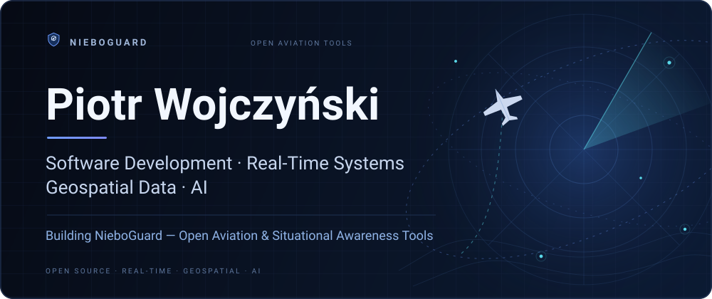
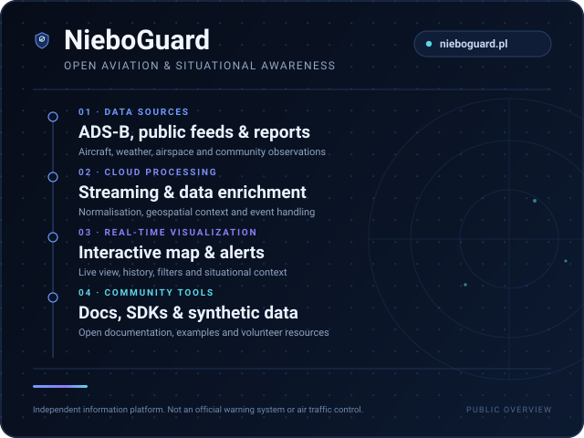

  

  <strong>Software Development · Real-Time Systems · Geospatial Data · AI</strong> 
  Building NieboGuard — open aviation &amp; situational awareness tools

# Hi, I'm Piotr

I build web platforms, real-time data systems, geospatial tools and AI-powered applications.

I'm an independent developer. My main focus is **NieboGuard**, an aviation and
situational awareness platform for Poland, and its public community toolkit. I
care about clear interfaces, reliable data pipelines and software that people can
actually use.

  
  
  

<strong>English</strong> · <a href="docs/README.pl.md">Polski</a>

## About me

I work across the stack, from data ingestion and event processing to the
interface that makes the data understandable.

- **Real-time data streaming** — event-driven pipelines, WebSocket updates and
  live state.
- **Web applications and PWAs** — fast, responsive interfaces with a focus on
  clarity.
- **Geospatial visualization** — interactive maps, coordinate systems and
  location-aware data.
- **Aviation data** — ADS-B processing, airspace context and protocol tooling.
- **AI-assisted processing** — computer vision, audio analysis and LLM-assisted
  workflows, always with human review.
- **Automation and developer tooling** — scripts, SDKs, CI and reproducible
  environments.
- **Open-source collaboration** — documentation, examples and maintainable
  public tooling.

## Currently building

### NieboGuard

**An interactive aviation map and situational awareness platform for Poland.**

[Website](https://nieboguard.pl/) · [Community repository](https://github.com/pwojczyn/NieboGuard-Community)

  

NieboGuard brings public aviation data, airspace information, official source
updates and community observations into one readable map. The project combines a
real-time data pipeline with a browser-based interface and a set of public tools
for learning, testing and contribution.

| Area | Status | Notes |
| :--- | :--- | :--- |
| Live interactive map | **Available** | Aviation layers, airspace zones, community reports and history views on [nieboguard.pl](https://nieboguard.pl/) |
| ADS-B and public data feeds | **Available** | Public ADS-B sources and official/open data; not a radar and not a replacement for official sources |
| Community reporting | **Available** | User-submitted observations are unverified and clearly separated from official data |
| History and analytics | **Available** | Time-window views for recent airspace activity |
| Alerts and notifications | **Available** | Regional alerts and source updates on the public site; not an official warning channel |
| AI situation assistant | **Preview** | Answers only from the public state of configured sources; it does not confirm a threat |
| AR sky view / sky scan | **Preview** | Experimental interface for nearby objects and horizon context |
| Computer vision and audio AI | **Experimental** | Audit tools and tutorials live in the community repository |
| Satellite data layer | **Experimental** | Public data layer; coverage and interpretation are limited |
| Mobile client | **Early test build** | Debug-signed test APK in the community repository; not a store release |

> **Important:** NieboGuard is an independent information platform. It is **not**
> an official public warning system and **not** air traffic control. It does not
> replace RCB alerts, sirens, emergency-service messages or 112. Data and
> community reports may be delayed, incomplete or unverified.

## Open source

### NieboGuard Community

[github.com/pwojczyn/NieboGuard-Community](https://github.com/pwojczyn/NieboGuard-Community)

The public home for the parts of the project that can be shared safely:
documentation, SDKs, synthetic sample data and community tools. Production code,
secrets, user data and infrastructure configuration stay private.

What is public today:

- **Sensor Hub** — an adapter-driven server for aviation and sensor data, with
  ADS-B parsing, ASTERIX CAT021/048/062 encoders, SQLite storage and REST/
  WebSocket interfaces. It is under active development: authentication and rate
  limiting are incomplete, full storage→API→WebSocket integration is partial,
  and ASTERIX support is encoder-only.
- **Protocol Knowledge Base** — public notes, sources and a compatibility matrix
  for ADS-B, ASTERIX and related formats.
- **Simulator and Protocol Lab** — synthetic traffic, replay, virtual radar and
  error-injection scenarios. All simulation data is explicitly synthetic.
- **JavaScript and Python SDKs** — small, dependency-light clients for the
  read-only public API.
- **Examples and sample data** — ADS-B, feed and state fixtures that are safe to
  run locally.
- **Volunteer and contributor material** — tutorials, task lists and GitHub
  templates.
- **One mobile test build** — a debug-signed APK with a published checksum; not a
  production release.

### Contributions welcome

Good first contributions:

- improve documentation, diagrams or Polish/English wording,
- add tests for adapters, encoders or the simulator,
- extend synthetic scenarios and sample data,
- share a sanitized ADS-B, audio or vision use case,
- report a reproducible bug through GitHub Issues.

Please do not post secrets, personal data, private coordinates or raw production
logs. Security issues should be reported privately.

- [Contributing guide](https://github.com/pwojczyn/NieboGuard-Community/blob/main/CONTRIBUTING.md)
- [Code of Conduct](https://github.com/pwojczyn/NieboGuard-Community/blob/main/CODE_OF_CONDUCT.md)
- [Security policy](https://github.com/pwojczyn/NieboGuard-Community/blob/main/SECURITY.md)
- [Open issues](https://github.com/pwojczyn/NieboGuard-Community/issues)

## How I work

   Real-time systems &nbsp;·&nbsp;
   Geospatial data &nbsp;·&nbsp;
   Cloud &amp; edge &nbsp;·&nbsp;
   AI-assisted tooling

I prefer small, observable systems: a clear data path, explicit status, graceful
degradation and a UI that tells the user what is known, what is estimated and
what is missing.

## Tech stack

**Frontend**
`HTML` · `CSS` · `JavaScript` · `PWA`

**Cloud and edge**
`Cloudflare Workers` · `Cloudflare Pages` · `D1` · `KV` · `R2` · `Durable Objects`

**Backend and data**
`Node.js` · `Python` · `Go` · `SQLite` · `REST` · `WebSocket`

**Infrastructure and automation**
`Linux` · `VPS` · `Docker` · `GitHub Actions`

**Data and visualization**
`ADS-B` · `ASTERIX` · `Geospatial data` · `Interactive maps` · `Real-time APIs`

**Earlier work**
`Java` · `Spring` · `MySQL` · `PHP`

The cloud list describes the high-level platform stack used across private
and public work. No infrastructure, account or deployment details are published.
Some capabilities are experimental; see the section below.

### Exploring

`Workers AI` · `LLM integration` · `Computer vision` · `Audio processing` · `Satellite data` · `AR interfaces`

These are active experiments, not production guarantees. Public examples and
audit tools for some of them are available in NieboGuard Community.

## Selected earlier work

- **[HostStats](https://github.com/pwojczyn/HostStats)** — a Spring Boot host
  monitoring dashboard with MySQL, REST and Nginx, published in 2017. Kept as an
  example of earlier full-stack work.

Other public repositories from 2017–2023 are learning projects and experiments.
They remain available in the [repositories tab](https://github.com/pwojczyn?tab=repositories),
but they are not presented here as current products. Forks are not listed as
original work.

## GitHub activity

<!-- STATS:START -->
| Metric | Value |
| :--- | :--- |
| Public repositories | **30** |
| Public source projects | **27** |
| GitHub since | **2017** |
| Top languages* | **JavaScript · HTML · CSS · Java · Go** |
| Last refreshed | **2026-11-02** |

* By language bytes across public non-fork repositories.
<!-- STATS:END -->

Updated automatically from public GitHub data. No third-party card service is
required for this section to render.

## Open to collaboration

I'm interested in projects involving:

- aviation and geospatial data tooling,
- real-time dashboards and event pipelines,
- offline-first and mobile-friendly web interfaces,
- AI-assisted data processing with clear human oversight,
- documentation, SDKs and developer experience.

Open an issue in [NieboGuard Community](https://github.com/pwojczyn/NieboGuard-Community/issues)
or use the [contact page](https://nieboguard.pl/contact).

---

  Independent software development · Aviation, geospatial data, real-time systems and AI 
  NieboGuard is not an official warning system or air traffic control service.

<strong>English</strong> · <a href="docs/README.pl.md">Polski</a>

