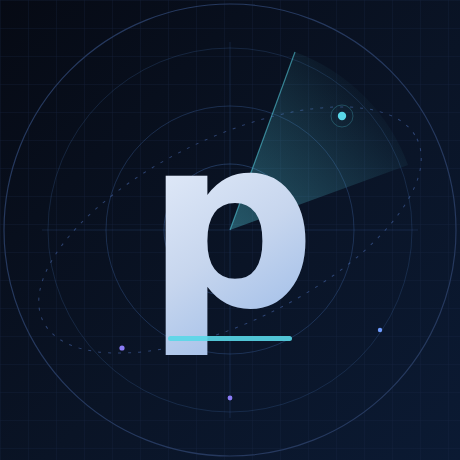

# Profile Settings and Avatar

This document contains the account-level settings that cannot be applied with the
current GitHub token. The repository token lacks the `user` scope, and GitHub has
no public API for uploading an avatar. The files below are ready to upload.

## Avatar



| Item | Value |
| :--- | :--- |
| Ready-to-upload file | [`assets/avatar.png`](../assets/avatar.png) |
| Editable source | [`assets/avatar.svg`](../assets/avatar.svg) |
| Size | 460 × 460 px |
| Format | PNG, 8-bit sRGB |
| Concept | Personal `p` monogram inside a radar/orbit field |

The mark is deliberately personal rather than a copy of the NieboGuard product
logo. It uses the same navy, blue, violet and cyan palette as the profile banner.
GitHub crops avatars to a circle, so the monogram and signal points stay well
inside the safe area.

### Upload

1. Open **GitHub → Settings → Public profile**.
2. Under **Profile picture**, choose **Edit → Upload a picture**.
3. Select `assets/avatar.png`.
4. Save and verify at <https://github.com/pwojczyn>.

There is no supported REST/GraphQL endpoint for changing a user avatar; this step
is always manual.

## Bio

The current public bio was changed externally during the task to a technology
stack summary. It was not overwritten. Choose one of the options below.

### Option A — recommended, product-focused

```text
Building NieboGuard — real-time systems, geospatial data, cloud & AI. Open source.
```

### Option B — original task wording

```text
Building NieboGuard | Real-Time Systems, Geospatial Data, Cloud & AI | Open Source
```

### Option C — shortest

```text
Independent developer building NieboGuard — aviation, geospatial and real-time systems.
```

GitHub limits the bio to **160 characters** and preserves line breaks. All three
options fit.

### Apply manually

1. Open **GitHub → Settings → Public profile → Bio**.
2. Paste the chosen text.
3. Save.

### Apply through the API (optional, requires a new scope)

Only if you explicitly want the bio and website updated through the API:

```bash
gh auth refresh -h github.com -s user
gh api -X PATCH user \
  -f name='pwojczyn' \
  -f bio='Building NieboGuard — real-time systems, geospatial data, cloud & AI. Open source.' \
  -f blog='https://nieboguard.pl/'
```

This changes the token scope and must be run by the account owner. It is not run
automatically by this repository.

## Website

Current: `https://nullexa.eu/`

Recommended: `https://nieboguard.pl/`

Set it in **Settings → Public profile → Website**, or with the `PATCH /user`
command above after granting the `user` scope.

## Display name

Current and recommended: `pwojczyn`.

No change is required. The banner and profile README also use this handle.

## Social links

Telegram links confirmed by the maintainer on 2026-11-03:

- Channel: <https://t.me/NieboGuard>
- App / bot: <https://t.me/NieboGuardBot> (`NieboGuard Map`)
- Community group: <https://t.me/nieboguardcommunity> (`NieboGuard Społeczność`)

The website source also links Facebook and Instagram. They are not added to the
profile until ownership is explicitly confirmed for those accounts. Do not add
YouTube, X/Twitter or TikTok; they were not found on the official site.

Verified links used in the README:

- Website: <https://nieboguard.pl/>
- GitHub: <https://github.com/pwojczyn>
- Community: <https://github.com/pwojczyn/NieboGuard-Community>
- Telegram: channel, bot and group above

## Pinned repositories

Recommended order:

1. `pwojczyn/pwojczyn` — the profile README.
2. `pwojczyn/NieboGuard-Community` — current public project.
3. `pwojczyn/HostStats` — optional, earlier full-stack work.

Unpin repositories that no longer represent current work. Pinning is a web-UI
setting; there is no supported API mutation for it.

## Checklist

- [ ] Upload `assets/avatar.png`.
- [ ] Choose and apply a bio option.
- [ ] Set website to `https://nieboguard.pl/`.
- [ ] Pin `pwojczyn/pwojczyn` and `pwojczyn/NieboGuard-Community`.
- [ ] Review old pinned repositories.
- [x] Add the confirmed Telegram channel, bot and group to the profile README.
- [ ] Add Facebook or Instagram only after explicit ownership confirmation.
