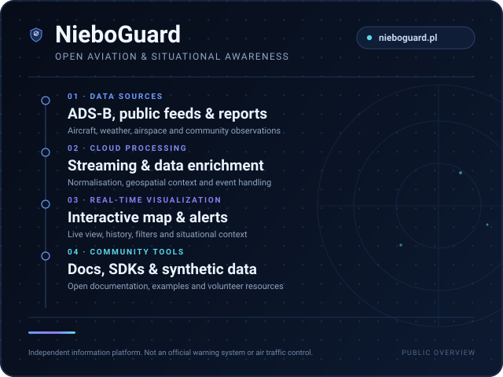

  

  <strong>Software Development · Systemy czasu rzeczywistego · Dane geoprzestrzenne · AI</strong> 
  Buduję NieboGuard — otwarte narzędzia dla lotnictwa i świadomości sytuacyjnej

# Cześć, jestem Piotr

Buduję platformy webowe, systemy danych czasu rzeczywistego, narzędzia
geoprzestrzenne i aplikacje wykorzystujące AI.

Jestem niezależnym deweloperem. Głównym projektem jest **NieboGuard** — platforma
świadomości sytuacyjnej i informacji lotniczej dla Polski — oraz jej publiczny
zestaw narzędzi społecznościowych. Zależy mi na czytelnych interfejsach,
niezawodnych potokach danych i oprogramowaniu, którego ludzie mogą faktycznie
używać.

  
  
  
  

<a href="../README.md">English</a> · <strong>Polski</strong>

## O mnie

Pracuję na całej szerokości stosu — od pozyskiwania danych i przetwarzania
zdarzeń po interfejs, który czyni te dane zrozumiałymi.

- **Strumienie danych w czasie rzeczywistym** — potoki oparte na zdarzeniach,
  aktualizacje WebSocket i żywy stan.
- **Aplikacje webowe i PWA** — szybkie, responsywne interfejsy nastawione na
  czytelność.
- **Wizualizacja geoprzestrzenna** — interaktywne mapy, układy współrzędnych i
  dane zależne od lokalizacji.
- **Dane lotnicze** — przetwarzanie ADS-B, kontekst przestrzeni powietrznej i
  narzędzia protokołowe.
- **Przetwarzanie wspierane przez AI** — computer vision, analiza dźwięku i
  przepływy z udziałem LLM, zawsze z nadzorem człowieka.
- **Automatyzacja i narzędzia deweloperskie** — skrypty, SDK, CI i powtarzalne
  środowiska.
- **Współpraca open source** — dokumentacja, przykłady i utrzymywalne publiczne
  narzędzia.

## Co obecnie buduję

### NieboGuard

**Interaktywna mapa lotnicza i platforma świadomości sytuacyjnej dla Polski.**

[Strona](https://nieboguard.pl/) · [Repozytorium społeczności](https://github.com/pwojczyn/NieboGuard-Community)

  

NieboGuard łączy publiczne dane lotnicze, informacje o przestrzeni powietrznej,
komunikaty źródeł oficjalnych i obserwacje społeczności w jednej czytelnej mapie.
Projekt łączy potok danych czasu rzeczywistego z interfejsem przeglądarkowym oraz
publicznymi narzędziami do nauki, testowania i współtworzenia.

Status w skrócie:

- **Interaktywna mapa na żywo** — **Dostępne** — Warstwy lotnicze, strefy
  przestrzeni powietrznej, zgłoszenia społeczności i widoki historii na
  [nieboguard.pl](https://nieboguard.pl/).
- **ADS-B i publiczne źródła danych** — **Dostępne** — Publiczne źródła ADS-B oraz
  dane otwarte/oficjalne; to nie radar i nie zastępstwo źródeł oficjalnych.
- **Zgłoszenia społeczności** — **Dostępne** — Obserwacje użytkowników są
  niezweryfikowane i wyraźnie oddzielone od danych oficjalnych.
- **Historia i analityka** — **Dostępne** — Widoki aktywności przestrzeni
  powietrznej w oknach czasowych.
- **Alerty i powiadomienia** — **Dostępne** — Alerty regionalne i aktualizacje
  źródeł na stronie publicznej; nie oficjalny kanał ostrzegania.
- **Asystent sytuacyjny AI** — **Podgląd** — Odpowiada wyłącznie na podstawie
  publicznego stanu skonfigurowanych źródeł; nie potwierdza zagrożenia.
- **Widok nieba AR / skan nieba** — **Podgląd** — Eksperymentalny interfejs dla
  obiektów w pobliżu i kontekstu horyzontu.
- **Computer vision i AI audio** — **Eksperymentalne** — Narzędzia audytowe i
  tutoriale w repozytorium społeczności.
- **Warstwa danych satelitarnych** — **Eksperymentalne** — Publiczna warstwa
  danych; pokrycie i interpretacja są ograniczone.
- **Klient mobilny** — **Wczesna wersja testowa** — Testowy APK podpisany kluczem
  debug w repozytorium społeczności; nie jest wydaniem sklepowym.

> **Ważne:** NieboGuard to niezależna platforma informacyjna. **Nie jest**
> oficjalnym systemem ostrzegania ludności ani kontrolą ruchu lotniczego. Nie
> zastępuje Alertów RCB, syren, komunikatów służb ani numeru 112. Dane i
> zgłoszenia społeczności mogą być opóźnione, niepełne lub niezweryfikowane.

## Poznaj NieboGuard

Publiczne punkty wejścia do platformy:

- [Mapa lotnicza na żywo](https://nieboguard.pl/) — dostępne
- [Skaner nieba / AR](https://nieboguard.pl/ar/) — podgląd
- [Zgłoszenia społeczności](https://nieboguard.pl/ar/safety/) — dostępne
- [Alerty i powiadomienia](https://nieboguard.pl/) — dostępne
- [Obserwacje lotnicze](https://nieboguard.pl/obserwacje-lotnicze/) — dostępne
- [Bezpieczna okolica](https://nieboguard.pl/bezpieczne-miejsca/) — dostępne
- [Asystent AI](https://nieboguard.pl/) — podgląd
- [Baza wiedzy](https://github.com/pwojczyn/NieboGuard-Community/tree/main/docs/knowledge-base) — dostępne
- [Protocol Lab](https://github.com/pwojczyn/NieboGuard-Community/tree/main/docs/protocol-lab) — dostępne

## Open source

### NieboGuard Community

[github.com/pwojczyn/NieboGuard-Community](https://github.com/pwojczyn/NieboGuard-Community)

Publiczne miejsce dla tych części projektu, które można bezpiecznie udostępnić:
dokumentacji, SDK, syntetycznych danych przykładowych i narzędzi społeczności.
Kod produkcyjny, sekrety, dane użytkowników i konfiguracja infrastruktury
pozostają prywatne.

Co jest publiczne obecnie:

- **Sensor Hub** — serwer oparty na adapterach dla danych lotniczych i sensorów,
  z parsowaniem ADS-B, enkoderami ASTERIX CAT021/048/062, bazą SQLite oraz
  interfejsami REST/WebSocket. Projekt jest w aktywnym rozwoju: uwierzytelnianie
  i rate limiting są nieukończone, pełna integracja storage→API→WebSocket jest
  częściowa, a obsługa ASTERIX obejmuje wyłącznie enkodery.
- **Protocol Knowledge Base** — publiczne notatki, źródła i macierz zgodności dla
  ADS-B, ASTERIX i powiązanych formatów.
- **Symulator i Protocol Lab** — syntetyczny ruch, odtwarzanie, wirtualny radar i
  scenariusze wstrzykiwania błędów. Wszystkie dane symulacyjne są jawnie
  syntetyczne.
- **SDK JavaScript i Python** — lekkie klienty publicznego API read-only.
- **Przykłady i dane przykładowe** — fixture'y ADS-B, feed i state, bezpieczne do
  uruchomienia lokalnie.
- **Materiały dla wolontariuszy i współtwórców** — tutoriale, listy zadań i
  szablony GitHub.
- **Jedna kompilacja testowa mobilna** — APK podpisany kluczem debug z
  opublikowaną sumą kontrolną; nie jest wydaniem produkcyjnym.

### Zapraszam do współpracy

Dobre pierwsze contributions:

- ulepszenie dokumentacji, diagramów lub brzmienia polskiego/angielskiego,
- dodanie testów adapterów, enkoderów lub symulatora,
- rozszerzenie scenariuszy syntetycznych i danych przykładowych,
- podzielenie się oczyszczonym przypadkiem użycia ADS-B, audio lub vision,
- zgłoszenie powtarzalnego błędu przez GitHub Issues.

Nie publikuj sekretów, danych osobowych, prywatnych współrzędnych ani surowych
logów produkcyjnych. Luki bezpieczeństwa zgłaszaj prywatnie.

- [Przewodnik współtworzenia](https://github.com/pwojczyn/NieboGuard-Community/blob/main/CONTRIBUTING.md)
- [Code of Conduct](https://github.com/pwojczyn/NieboGuard-Community/blob/main/CODE_OF_CONDUCT.md)
- [Polityka bezpieczeństwa](https://github.com/pwojczyn/NieboGuard-Community/blob/main/SECURITY.md)
- [Otwarte zgłoszenia](https://github.com/pwojczyn/NieboGuard-Community/issues)

## Jak pracuję

   Systemy czasu rzeczywistego &nbsp;·&nbsp;
   Dane geoprzestrzenne &nbsp;·&nbsp;
   Chmura i edge &nbsp;·&nbsp;
   Narzędzia AI

Preferuję małe, obserwowalne systemy: czytelną ścieżkę danych, jawny status,
łagodną degradację i interfejs, który mówi użytkownikowi, co jest znane, co jest
oszacowane, a czego brakuje.

## Stos technologiczny

**Frontend**
`HTML` · `CSS` · `JavaScript` · `PWA`

**Chmura i edge**
`Cloudflare Workers` · `Cloudflare Pages` · `D1` · `KV` · `R2` · `Durable Objects`

**Backend i dane**
`Node.js` · `Python` · `Go` · `SQLite` · `REST` · `WebSocket`

**Infrastruktura i automatyzacja**
`Linux` · `VPS` · `Docker` · `GitHub Actions`

**Dane i wizualizacja**
`ADS-B` · `ASTERIX` · `Dane geoprzestrzenne` · `Interaktywne mapy` · `API czasu rzeczywistego`

**Wcześniejsze doświadczenie**
`Java` · `Spring` · `MySQL` · `PHP`

Lista chmurowa opisuje ogólny stos platformy wykorzystywany w pracy prywatnej
i publicznej. Żadne szczegóły infrastruktury, kont ani wdrożeń nie są publikowane.
Część możliwości jest eksperymentalna; patrz sekcja poniżej.

### Exploring

`Workers AI` · `Integracja LLM` · `Computer vision` · `Przetwarzanie audio` · `Dane satelitarne` · `Interfejsy AR`

To aktywne eksperymenty, nie gwarancje produkcyjne. Publiczne przykłady i
narzędzia audytowe dla części z nich są dostępne w NieboGuard Community.

## Wybrane wcześniejsze projekty

- **[HostStats](https://github.com/pwojczyn/HostStats)** — dashboard monitoringu
  hostów w Spring Boot z MySQL, REST i Nginx, opublikowany w 2017 roku. Zachowany
  jako przykład wcześniejszej pracy full-stack.

Pozostałe publiczne repozytoria z lat 2017–2023 to projekty edukacyjne i
eksperymenty. Pozostają dostępne w [zakładce repozytoriów](https://github.com/pwojczyn?tab=repositories),
ale nie są tutaj prezentowane jako aktualne produkty. Forki nie są przedstawiane
jako praca własna.

## Aktywność na GitHubie

<!-- STATS:START -->
| Metryka | Wartość |
| :--- | :--- |
| Publiczne repozytoria | **30** |
| Publiczne projekty źródłowe | **27** |
| Na GitHubie od | **2017** |
| Najczęstsze języki* | **JavaScript · HTML · CSS · Java · Go** |
| Ostatnia aktualizacja | **2026-11-02** |

* Według bajtów języka w publicznych repozytoriach niebędących forkami.
<!-- STATS:END -->

Sekcja jest aktualizowana automatycznie na podstawie publicznych danych GitHub.
Do jej wyświetlenia nie jest potrzebna zewnętrzna usługa kart statystyk.

## Otwarty na współpracę

Interesują mnie projekty związane z:

- narzędziami dla danych lotniczych i geoprzestrzennych,
- dashboardami czasu rzeczywistego i potokami zdarzeń,
- interfejsami webowymi typu offline-first i mobilnymi,
- przetwarzaniem danych wspieranym przez AI z jasnym nadzorem człowieka,
- dokumentacją, SDK i developer experience.

Otwórz zgłoszenie w [NieboGuard Community](https://github.com/pwojczyn/NieboGuard-Community/issues)
lub skorzystaj ze [strony kontaktowej](https://nieboguard.pl/contact).

## Telegram

- **Kanał:** [@NieboGuard](https://t.me/NieboGuard)
- **Aplikacja / bot:** [@NieboGuardBot](https://t.me/NieboGuardBot)
- **Grupa społeczności:** [@nieboguardcommunity](https://t.me/nieboguardcommunity)

---

  Niezależny rozwój oprogramowania · Lotnictwo, dane geoprzestrzenne, systemy czasu rzeczywistego i AI 
  NieboGuard nie jest oficjalnym systemem ostrzegania ani kontrolą ruchu lotniczego.

<a href="../README.md">English</a> · <strong>Polski</strong>

